<h1 align="center">wander</h1>

<p align="center">
  A journal and a writing app.<br>
  Plain markdown on disk, set like a page rather than a text box.
</p>

<p align="center">
  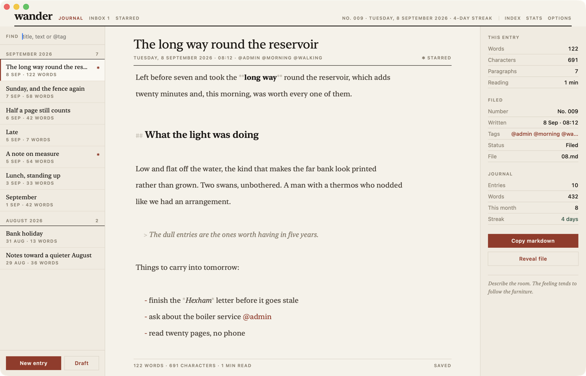
</p>

Every entry is a plain markdown file in the [jnl](https://github.com/Caddickbrown/jnl)
layout — one file per day, drafts in an inbox, `@tags` inline. No database, no
sidecar files, no export. The macOS app, the iOS app, the Linux app and the
`jnl` CLI all read and write the same folder, byte for byte.

---

## Markdown, styled where you type it

There is no preview pane and no split screen. A heading looks like a heading
while you are writing it: the display serif takes the size, and the `##` fades
to a hairline grey beside it. Quotes go italic and indent, code takes a tinted
monospace, `@tags` and links take the accent. The file on disk is still the
markdown you typed.

| | |
|---|---|
| Warm paper `#f6f2ea`, ink `#171310`, one terracotta accent `#9c3220` | Newsreader for anything that reads as writing, IBM Plex Sans for anything that reads as apparatus |

## Focus mode

`⌘⇧F` closes every column and dims everything but the paragraph under the
caret. The masthead stays, because you should always be able to see what you
are writing into.

<p align="center">
  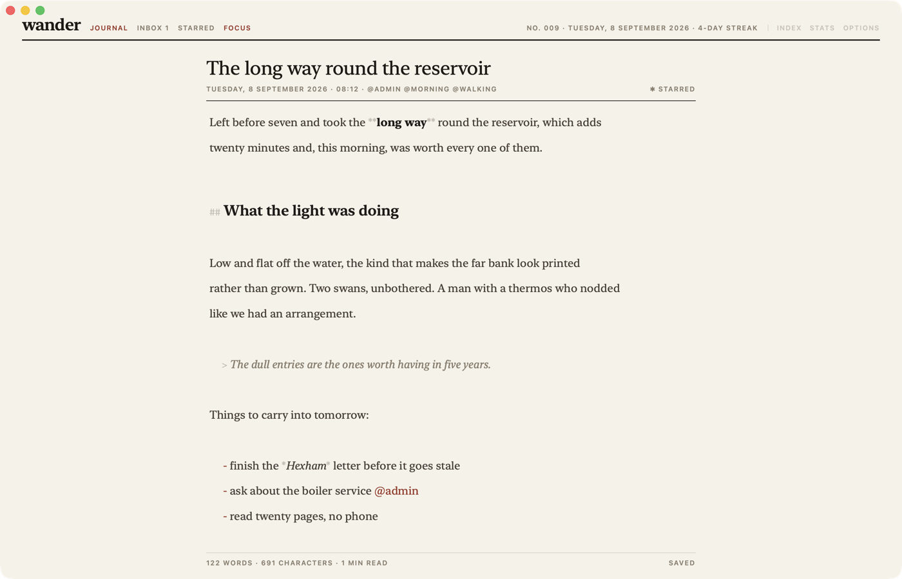
</p>

## Three pages, one folder

**Journal** is what has been filed, by month. **Inbox** is what hasn't —
undated drafts in `inbox.md`, for writing that isn't ready to belong to a day.
Every entry starts there, since new writing rarely is. **Starred** cuts across
both. The page you are on sits first in the masthead in
terracotta; the others follow in grey. Only the inbox carries a count, because
only the inbox is a queue.

<p align="center">
  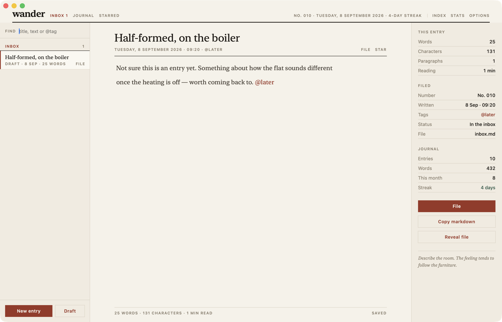
</p>

Filing a draft moves it from `inbox.md` into `journal/YYYY/MM/DD.md` under its
own timestamp — `⌘J`, or the **File** switch on the row, in the header, or in
the stats column.

## The columns

The index, the page, and two panels — **Stats** and **Options** — each of which
slides in and out of the masthead switches or `⌘\`, `⌘⇧\`, `⌘⌥\`.

<p align="center">
  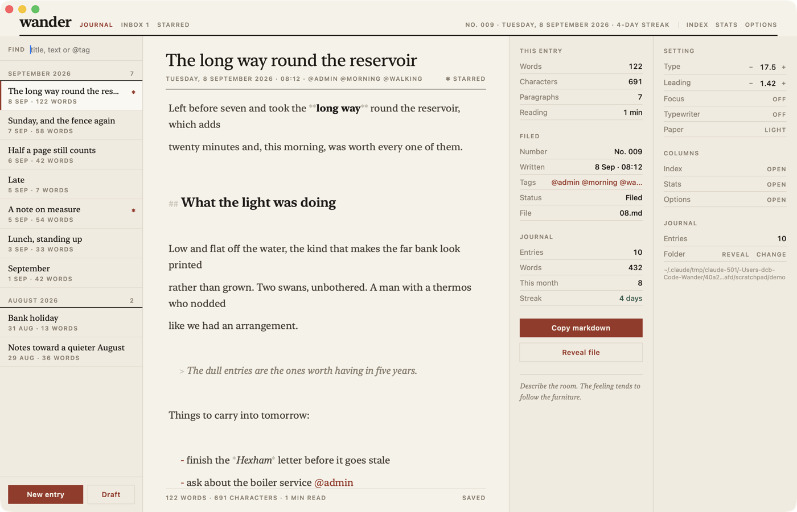
</p>

Type size, leading, focus, typewriter scrolling and paper are all set from
Options, and every one of them is remembered.

## Date and time

The date is the filename, so changing it moves the entry between day files —
the sheet says so before it does it. Days that already hold entries carry a
dot. A draft stays in `inbox.md`, which isn't dated, so retiming one never
quietly files it.

<p align="center">
  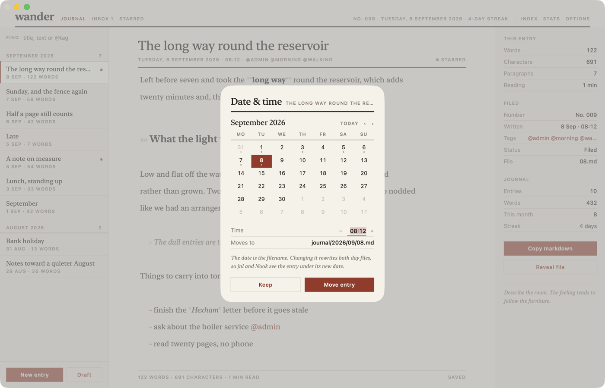
</p>

## Dark

The same hue family, inverted — warm neutral rather than blue-grey. Auto,
Light, or Dark; the Dock icon follows. Every theme below carries both, so the
setting stays a switch rather than a different app.

<p align="center">
  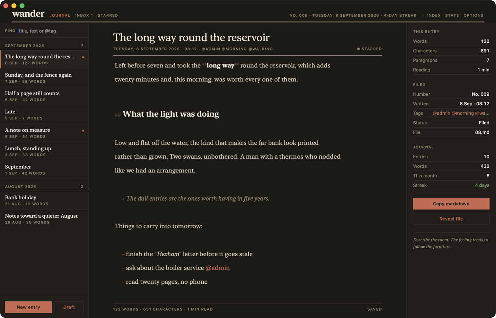
</p>

## Fourteen looks

A theme here is not a palette swap with the same app underneath. It sets the
faces, the measure, the leading, the rules, the shape of the buttons and the
way the stats column is drawn. **Almanac** — the warm paper above — is the one
it opens in. **Broadsheet** centres the masthead over a double rule and runs
the day as a front page. **Cinema** letterboxes the window and sets the title
in Oswald caps against one blood red. **Editorial** takes a slab headline and
spends its magenta twice. **Memphis** puts the page on a card with a hard drop
shadow and colours the index rows.

<table>
<tr>
<td width="50%">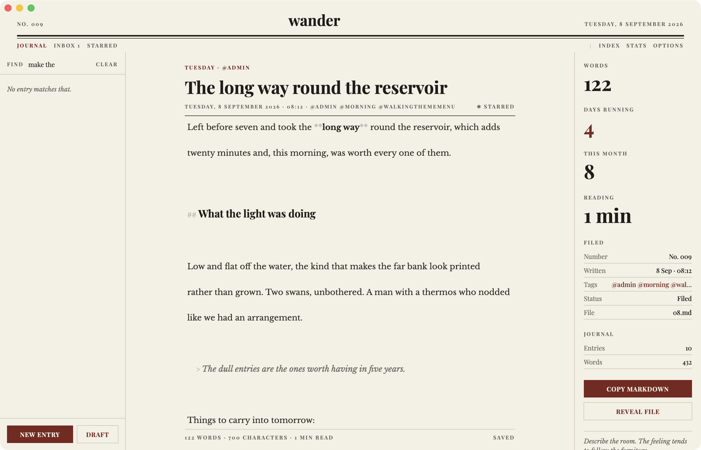</td>
<td width="50%">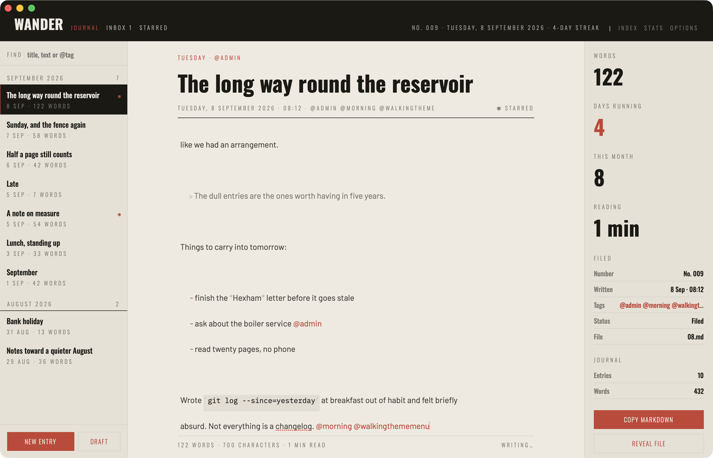</td>
</tr>
<tr>
<td width="50%">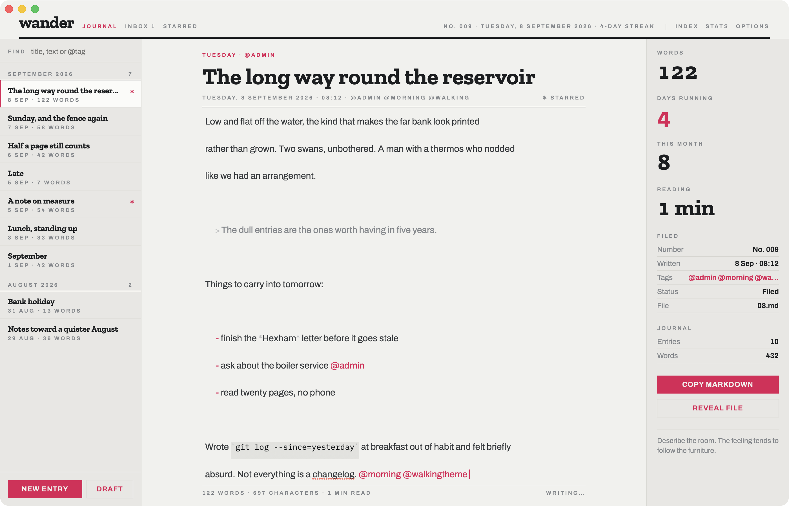</td>
<td width="50%">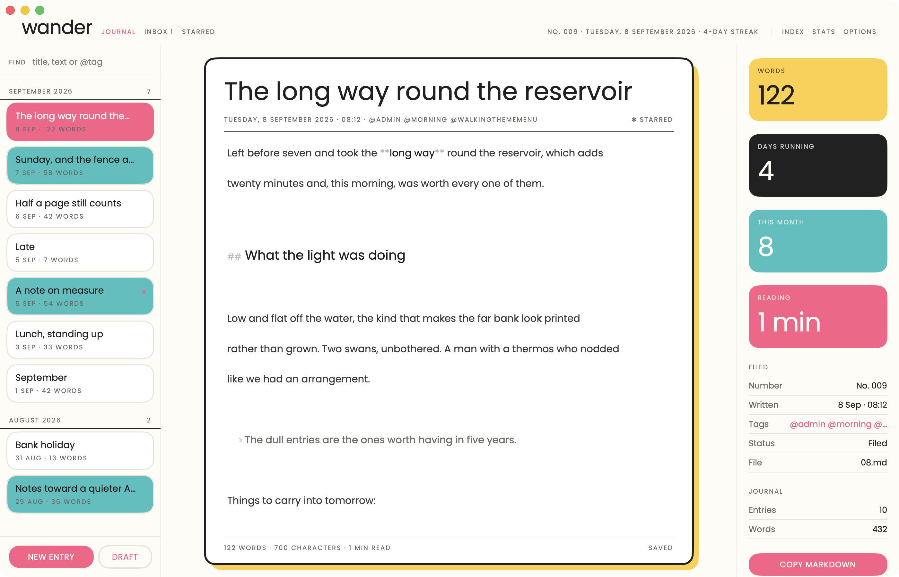</td>
</tr>
</table>

They are chosen from **Options ▸ Theme**, on a page where each is drawn in its
own colours and its own type rather than named in a list — the decision is made
by looking. The cards preview in whichever of Light and Dark the picker is set
to, and the dot beside each name — light, dark, or one half of each — says
which it was drawn for. Picking one brings its type size and leading with it;
the Options steppers move them afterwards.

<p align="center">
  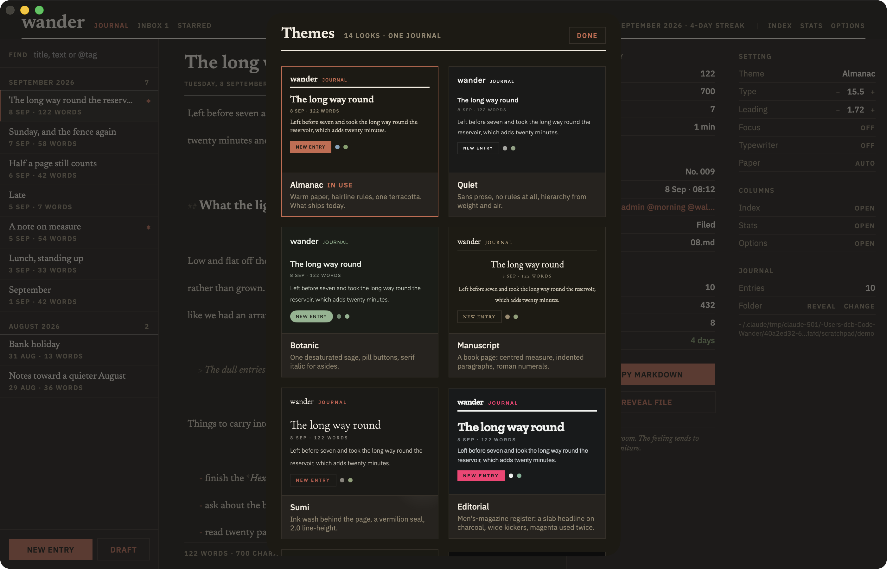
</p>

All fourteen live in one file — `Resources/themes.json`, kept byte-identical at
`tauri/src/themes.json` — as colours, faces and a short list of furniture
switches. Adding a look is editing that file, and it arrives on macOS, iOS and
Linux together.

## On iPhone and iPad

The phone opens on the page you were writing, with the index a tap away. The
iPad lays it out as the Mac does. Themes are swiped through full size rather
than picked off a grid, and the home-screen icon follows the one you choose.

<table>
<tr>
<td width="33%">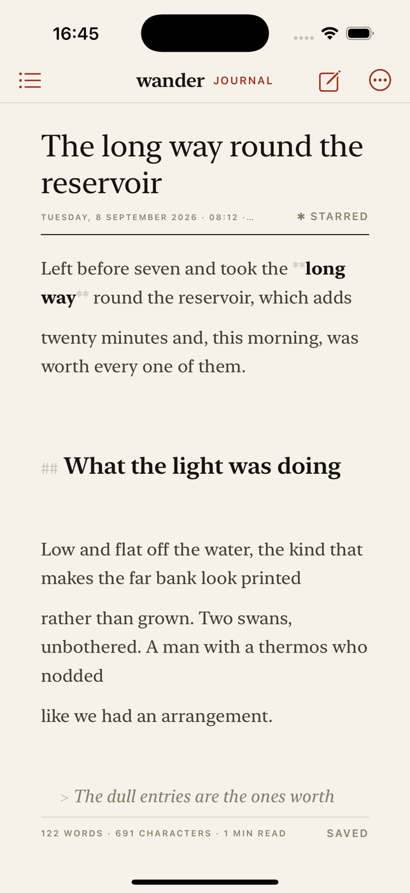</td>
<td width="33%">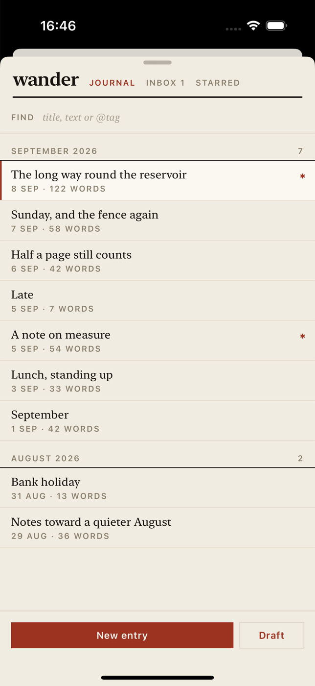</td>
<td width="34%">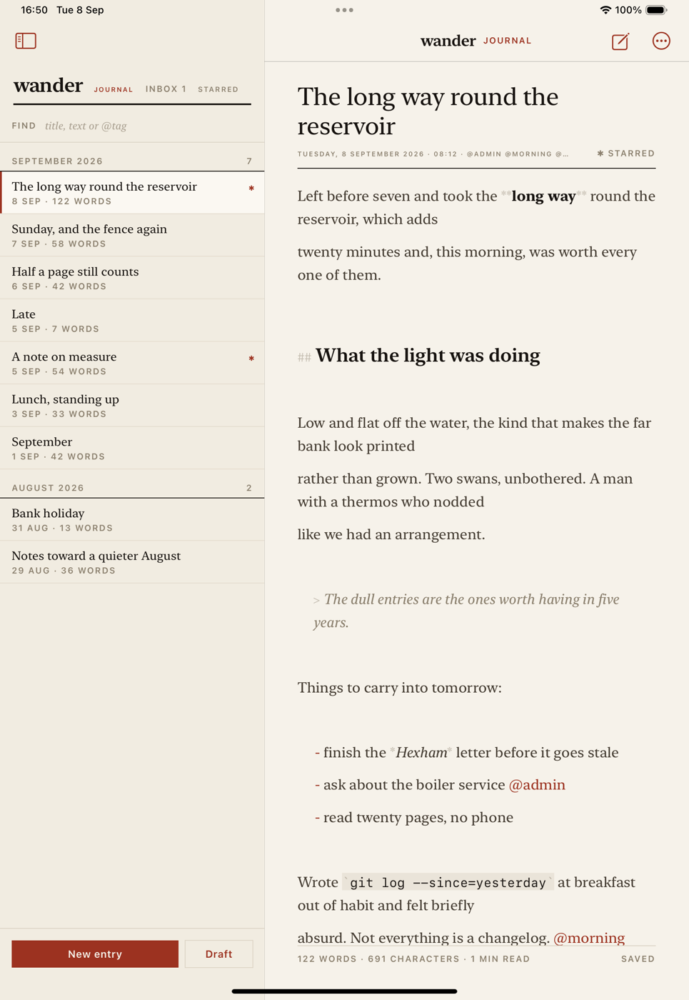</td>
</tr>
</table>

## On Linux and Windows

SwiftUI doesn't run on Linux, so the Linux build isn't a port — it's a Tauri
app over the same folder, drawn to match. Newsreader and IBM Plex Sans are
bundled with it, so it looks the same on a machine that has neither installed.

There, the window has no title bar: the masthead is the bar. Drag it to move
the window; the three glyphs at its right minimise, maximise and close. macOS
keeps its own title bar, since its traffic lights are better than anything
drawn here — `WANDER_DECORATIONS=0` takes them away, `=1` puts them back.

<p align="center">
  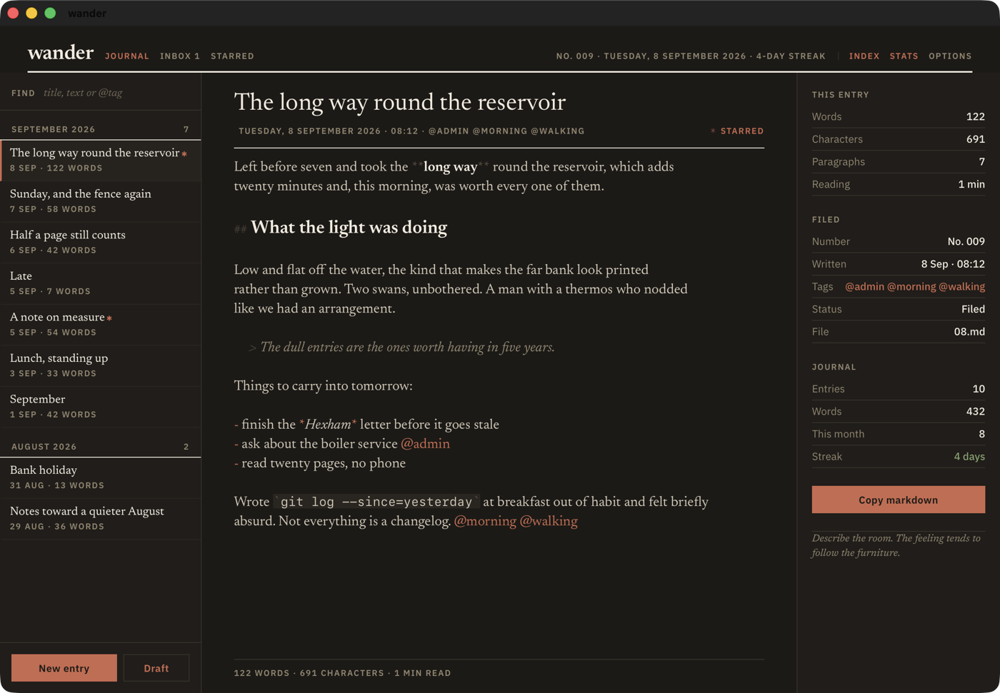
</p>

---

## The format

```
<journal>/journal/YYYY/MM/DD.md   one file per day
<journal>/inbox.md                undated drafts
```

```markdown
[2026-09-08 08:12:00] The long way round the reservoir *
Left before seven and took the **long way** round the reservoir, which adds
twenty minutes and, this morning, was worth every one of them.

## What the light was doing

> The dull entries are the ones worth having in five years.

- ask about the boiler service @admin
```

A `[YYYY-MM-DD HH:MM:SS] optional title` header line and its body. A trailing
`*` on the title means starred. `@tags` live inline, and are deduplicated when
listed. Anything before the first header in a file is preserved across writes.

The journal folder is an explicitly chosen one, else `$JNL_DIR` — so an
existing jnl or Nook journal opens as-is — else `~/Documents/Wander`. Change it
in **Options ▸ Folder ▸ Change** on any of the three: an open panel on macOS,
the document picker on iOS, and a native folder dialog on Linux and Windows.

The choice is remembered where each platform keeps such things — a
security-scoped bookmark in UserDefaults on macOS and iOS, so it survives the
folder being moved or renamed, and `~/.config/wander/folder` on Linux
(`~/Library/Application Support/wander/folder` on macOS). The Tauri build also
takes a folder as its first argument: `wander ~/Notes`.

## Building

| | |
|---|---|
| **macOS** | `./build.sh --run`, or the `wander (macOS)` scheme in the Xcode project |
| **iOS / iPadOS** | `xcodegen generate && open Wander.xcodeproj`, scheme `wander (iOS)` |
| **Linux, Windows, macOS** | `cd tauri/src-tauri && cargo run` |

Both Apple builds are signed with the same Apple Development identity and team
as Nook (`52W73J6V95`); the Mac app also gets the hardened runtime. Signing
falls back to ad-hoc when no certificate is installed, so `./build.sh` works on
a machine without the developer account.

`WanderCore/` is the shared Swift core — the model, the jnl parser and
every file operation, Foundation only — used by both Apple builds.
`tauri/src-tauri/src/journal.rs` is a second, deliberate port of the same
format in Rust; the two are kept byte-compatible on purpose.

```
WanderCore/            the shared Swift package: model, parser, every read and write
Sources/Wander         macOS app, and the views and store both Apple builds share
Sources/WanderiOS      the iPhone and iPad shell
tauri/                 the Tauri app: Rust journal port, HTML/CSS/JS interface
tools/make_icon.swift  redraws the icon in both palettes
```

## Keys

| | |
|---|---|
| `⌘N` | new entry, in the inbox |
| `⌘1` `⌘2` `⌘3` | journal / inbox / starred |
| `⌘J` | file a draft, or return an entry to the inbox |
| `⌘D` / `⌘⇧D` | star / change date and time |
| `⌘F` | find |
| `⌘\` `⌘⇧\` `⌘⌥\` | index / stats / options columns |
| `⌘⇧F` / `⌘⇧T` | focus mode / typewriter scrolling |
| `⌘B` `⌘I` | wrap the selection in `**` / `_` |
| `⌘⌥↑` `⌘⌥↓` | previous / next entry |

## Credits

Newsreader and IBM Plex Sans are used under the SIL Open Font Licence 1.1;
the licence ships with the fonts in `tauri/src/fonts`.
